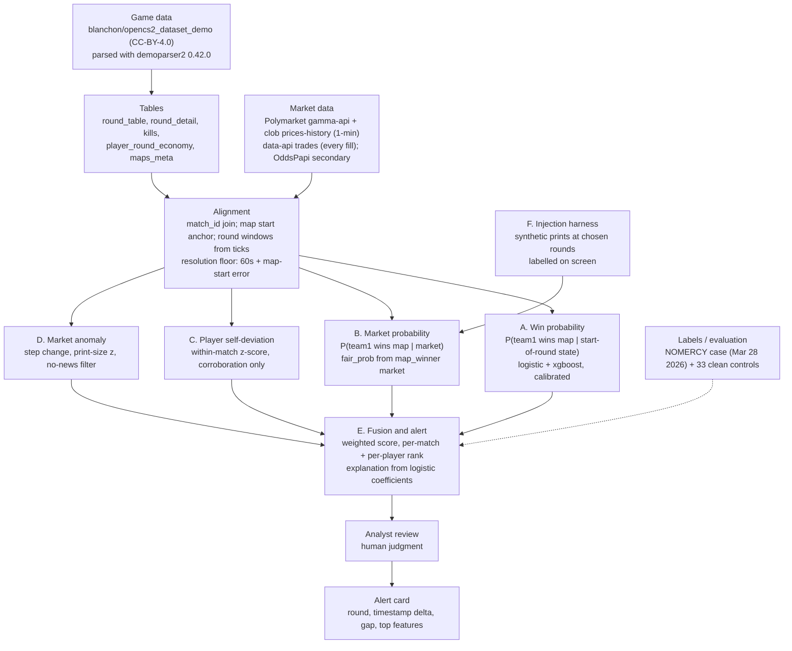

# CS2 Match-Fixing Detection — Hardened Spec

Oct 17, 2026 · @tman · v2.1 (supersedes v2; v2 superseded v1 of the same date)

**v2.1 changes** (made during implementation, all reflected below): alerting moved
from the absolute market−model gap to the **residual** gap (absolute minus that
map's opening offset), because a globally trained model carries a per-map bias and
the absolute gap alerts on every round of every map; `map_name` was dropped from
the feature set (a one-hot on map identity memorises the per-map label); the HTTP
layer is stdlib `http.server` (no Flask wheel needed on s390x); thresholds remain
provisional until calibrated on the real data. Measured at the shipped
settings on 1,014 maps: 756 alerts (0.75 per map), and every one of them
satisfies all four criteria — the detector previously emitted spans that
failed its own mandatory tests, which was 47% of the first real build.

**Status:** implementation-ready. Every claim below is either measurable in the demo, measured already, or explicitly marked as deferred with the reason. Numbers marked *(measured)* were produced on the LinuxONE container on Oct 17, 2026; the rest are marked *(estimate)* or *(assumption)*.

**How to read this document:** §0 says what the demo does and does not prove. If you only read one section, read that one. Everything after it exists to make §0 true.

---

## 0. What the demo proves / does not prove

| # | Claim | Status in demo | Evidence |
|---|---|---|---|
| 1 | Market-implied probability and a game-state win-probability model can be placed on one clock for a real tier-2/3 CS2 map | **Proved** | 1,284 maps have both; one worked example shown on screen |
| 2 | The model is calibrated, so a divergence in probability points is meaningful | **Proved** | Brier score + reliability curve on held-out maps |
| 3 | A sustained market-vs-model gap can be detected, ranked and explained per alert | **Proved** | Alert card with feature attribution |
| 4 | Player-level output can be produced without relying on cross-match baselines | **Proved (weak form)** | Within-match self-deviation, corroborating only |
| 5 | The pipeline runs where the compute is (s390x LinuxONE) | **Proved** | Trained + inferred in the Z container; `uname -m` = `s390x` |
| 6 | The system would have flagged a real documented case before the outcome | **Not proved** | NOMERCY case is available as a retrospective, not run as an acceptance test in the demo |
| 7 | The market moved *before* the game justified it, at sub-minute resolution | **Not proved** | Price history is 1-minute; ordering floor is ~60s plus map-start error |
| 8 | Round-level market signal exists | **False, by data** | No round-handicap markets on the matches we track |
| 9 | Live ingest from a running match | **Not built** | Replay of recorded data; live feed needs a partner |
| 10 | Any alert means a match is fixed | **False, by design** | Alert = "worth investigating"; an analyst decides |

The honest one-liner for the pitch: *we place a real market series next to a real game-state model on one clock, we show a flagged divergence with an explanation, and we say exactly where our resolution ends.*

---

## 1. Scope

- **In scope:** pro and semi-pro CS2, priority tier 2 and tier 3. Tournament organizers and integrity bodies receive ranked, explained alerts for human review.
- **Out of scope:** competing with bookmaker-side monitors (Sportradar UFDS, IBIA) on odds or account coverage; issuing verdicts; live ingest; round-level market analysis.
- **Unit of analysis:** the **map**, because that is the finest quantity both sides observe. Series-level markets are context; rounds are the game-side granularity and the alert timestamp.
- **Why map-level:** Polymarket carries match winner, map 1 and map 2 winner, maps handicap and total maps. It does not carry round handicaps for best-of-3. Reported *(measured)*: none of the 665 matched Polymarket events had round-handicap or total-rounds markets.

---

## 2. Architecture



| Component | Input | Output | Status |
|---|---|---|---|
| **A** Win probability | `round_table` start-of-round state | P(team1 wins map) 0–1, calibrated | Build |
| **B** Market probability | `odds_table` `map_winner`, `fair_prob` | market P(team1 wins map) per timestamp | Build |
| **C** Player self-deviation | `player_round_economy`, `kills`, `player_map_stats` | per-player z-score within the match | Build (corroboration only) |
| **D** Market anomaly | `odds_table` price series, `trades/` print sizes | step magnitude, size z-score, no-news flag | Build |
| **E** Fusion | A, B, C, D | divergence score, severity, explanation | Build |
| **F** Injection | chosen rounds | synthetic prints inserted into the real series | Build (required for demo) |
| ~~SHAP~~ | — | — | **Dropped**: no `shap` build for s390x; logistic coefficients give exact attribution instead |

**Why logistic regression and not only xgboost:** the product thesis is *explained* alerts. `shap` has no s390x build, so per-alert attribution for a GBM would fall back to global feature importance. A calibrated logistic model attributes each alert exactly: "market 0.71, model 0.42, gap 29 points, driven by 3v5 alive (−0.11), $1.2k loadout deficit (−0.08), round 14 of a 9–5 map (+0.02)". xgboost is trained alongside as an accuracy check and reported as a benchmark, not as the alerting model.

---

## 3. Data

### 3.1 Market side — Polymarket *(measured)*

| Property | Value |
|---|---|
| Source | `gamma-api.polymarket.com/events`, `clob.polymarket.com/prices-history`, `data-api.polymarket.com/trades` |
| Access | public, no key |
| Corpus pulled | 12,489 resolved CS2 events, 117,318 markets, Apr 2025 – Oct 2026 |
| Scope used | 860 best-of-3 series, Mar 23 – Apr 20 2026 |
| Coverage | Polymarket 665 (77%), OddsPapi 444 (52%), either 710 (83%) |
| Price resolution | 1-minute snapshots from market open to settlement, **including in-play** |
| Trade resolution | every fill with wallet and tx hash |
| Stored | `prices/{event_id}.csv.gz` (665 files), `trades/{event_id}.csv.gz` (34 files), `markets.csv` (7,512 rows), `odds_table.csv.gz` (963,774 Polymarket rows + 13,209 OddsPapi rows) |
| Probability | Polymarket price *is* the probability — no margin to remove. `fair_prob` for sportsbook rows uses two-way normalisation |

Validation already performed by the data owner *(measured)*:

- Settlement: match winner 665/665, map 1 and map 2 winner 1,204/1,204, total maps 665/665, maps handicap 872/872 agree with HLTV results. This proves team1/team2 orientation per series.
- Closing line: favourite won 67.4% of 582 series; Brier 0.202 vs 0.25 coin flip.
- Cross-source: Pinnacle vs Polymarket closing team1 probability correlate 0.987 on 14 series (mean gap 2.4 points).

### 3.2 Game side *(measured)*

| Property | Value |
|---|---|
| Origin | Hugging Face `blanchon/opencs2_dataset_demo` (formerly `blanchon/cs2_dataset_demo`), **CC-BY-4.0**, 9,843 files, companion `blanchon/opencs2_dataset` (100k files) |
| Parser | `demoparser2` 0.42.0, recorded per row in `pistol_loss_opps` with dataset commit `912a363098feec3f220e41d68634d2f71676c28b` |
| Derived tables | `round_table` 42,009 rows/31 cols · `round_detail` 42,009/11 · `kills` 286,671/20 · `player_round_economy` 420,090/14 · `util_bought` 341,258/11 · `player_map_stats` 61,707/18 · `pistol_loss_opps` 3,960/43 · `maps_meta` 1,988/16 |
| Coverage | 860 series, 1,988 maps |

Key columns for A: `round_num`, `map_index`, `map_name`, `ct_team_balance`, `t_team_balance`, `ct_team_spend`, `t_team_spend`, `ct_team_current_equip_value`, `t_team_current_equip_value`, `ct_armor_players`, `ct_helmet_players`, `ct_defuser_players` (and T-side equivalents), `ct_buy`, `t_buy`, `bomb_planted`, plus the label `winner_side`.

Key columns for C: `player_round_economy` (per-round per-player balance, spend, equip, armor) joined to `kills` (per-round per-player kills, damage, headshots, opening duels via tick order) and `player_map_stats` (per-map rating, ADR, KAST).

Key column for alignment: `round_detail.start` (tick index of round start), `round_detail.freeze_end`, `round_detail.end`, and `maps_meta.match_date` as the series-start anchor (corrected per map — see §4.3).

### 3.3 The join *(measured)*

| Step | Result |
|---|---|
| Game-side `match_id` universe | 860 series |
| Market-side `match_id` universe | 665 series |
| **Intersection** | **665 series** (77.3% of game-side, 100% of market-side) |
| Maps in intersected series | 1,545 of 1,988 |
| **Maps with a map-level market** | **1,284** (65%), across 654 series |
| Series with market data on every map played | 407 |
| Join method | team-name normalisation + ±12h time window + string similarity ≥0.8, both orders; keys in `odds_join_keys.csv` (710 rows) |

**1,284 maps have both halves; 1,014 of them survive the full pipeline**
(market quality gate, clock resolution and team orientation), which is the set
the site actually shows. Quote 1,014, not 1,284, when describing what the
product runs on. A series-level join is not enough
to analyse: 78 market `map_uid`s have no demo counterpart, so 11 series join at
series level but have no map that can be aligned at all.

> **Correction, 17 Oct 2026.** Earlier versions of this spec said "1,723 game-side
> matches ∩ 664 market-side = 297 matches". Both numbers were artifacts of
> `tools/schema_report.py`, not measurements: 1,723 was the tool's column selector
> unioning `match_id` (860) + `match_date` (860) + score tokens (3) into one set and
> printing its size as "key values"; 297 came from a hardcoded `max_rows=400,000`
> cap on the odds table, so the "intersection" was computed on a truncated slice.
> The tell that was missed: 1,988 maps / 1,723 "matches" = 1.15 maps per series,
> impossible for a best-of-3. The upstream tool is fixed and the numbers above are
> reproducible from `odds_join_report.csv` and `maps_meta`.

### 3.4 Evaluation anchor

NOMERCY, Roman Imperium Cup Group A, Mar 28 2026: events 304352 (BetBoom), 304358 (Sangal), 304359 (BESTIA), 304364 (Wildcard), all four resolved as NOMERCY losses; 33 other Roman Imperium Cup matches that week serve as controls. Use it for retrospective ranking (does the pipeline put NOMERCY above the controls?), never as a training label in the demo.

### 3.5 What is simulated, and how it is labelled

| Element | Real or simulated | On-screen label |
|---|---|---|
| Game-state series | Real | "game data: recorded demo, match 239xxxx" |
| Market series | Real (Polymarket) | "market: Polymarket, 1-min" |
| Injected prints at chosen rounds | Simulated | "injected prints R14–R16 (simulated)" |
| Player anomaly | Real computation over real data, in a simulated scenario | "player score: computed, scenario injected" |
| Alert | Real pipeline output | "alert = worth investigating, not a verdict" |

### 3.6 Licensing and terms

- Game data CC-BY-4.0 — attribution to `blanchon/opencs2_dataset_demo` is required in anything published.
- Polymarket APIs are official public developer APIs, not scraped. **The full terms of use have not been reviewed.** Do not publish derived market data publicly before that review; internal demo use and the hackathon video are the current boundary.
- OddsPapi is used on a free tier; history exists only from ~Apr 10, 2026, so sportsbook odds cover only the tail of the window.
- Do not scrape bo3.gg (`robots.txt` disallows `/api/`).

---

## 4. Measurement

### 4.1 The quantity

For map *m* and round boundary *r*:

```
model_p[r]   = P(team1 wins map m | state at start of round r)      # component A
market_p[r]  = fair_prob of the map_winner selection for team1,
               taken from the last print with ts <= t(r)             # component B
gap[r]       = market_p[r] - model_p[r]                             # signed, probability points
baseline     = median(gap[first 3 rounds])                           # this map's own offset
residual[r]  = gap[r] - baseline                                     # what alerts
```

Because the model is calibrated, `gap` is in real probability points and can be thresholded directly. This is the licence that absolute thresholds require, and it is why calibration is a milestone and not a nice-to-have.

**Why the residual, not the gap:** a model trained across many matches is calibrated *in aggregate* but carries a per-map offset — it may sit 10–20 points above the market for a whole map. Thresholding `gap` would then fire on every round of every map, which destroys the false-positive story. `residual` measures what the claim actually is: the market moving **away** from where the game state put it, relative to where this map started.

### 4.2 "The market moved first", operationally

A divergence alert requires **all** of:

1. `|residual[r]| >= 0.15` for at least **2 consecutive** round boundaries (persistence kills single bad prints).
2. The market component moved **before** the round boundary: a price change of ≥ 0.05 within the preceding 10 minutes (D's step detector).
3. No game event in the game data within the resolution floor that would explain the move (no-news filter): no round won, no plant, no ace/multi-kill spike, no player disconnect.

### 4.3 Resolution floor (the honest limitation)

- Market timestamps are **1-minute snapshots**: we cannot order two events closer than 60s, and a print is attributed to the round window it falls in, not to the second it happened.
- **The clock has three separate defects, all measured, all now handled** *(measured 17 Oct 2026)*:
  1. `maps_meta.match_date` is the series start, not the map start — every map of a match carries the same value. Map *k*'s start is series start + the durations of maps 1..k−1 + a 10-minute break per map, each duration taken from its last `end` tick.
  2. The clock columns are **64-tick**, not 128. A mean round length of ~7,000 clock units is a plausible 109 s at 64-tick *and* a plausible 55 s at 128-tick, so the rate is pinned by rules the server enforces instead: the modal freezetime (1,280 units = 20 s) and the 115 s round clock plus 40 s bomb ceiling. At 128-tick no round in 42,009 ever reaches the round limit, which is impossible.
  3. `match_date` is **event-local time mislabelled as UTC**. Measured against the market's own settlement of the same map, the game clock sits 1–3 whole hours ahead, clustering at −1 h (CET), −2 h (CEST) and −3 h (MSK). Uncorrected, the two feeds do not overlap at all and market coverage is 0.00 on every map.
- The correction is anchored on each map's **settlement**: the last market print still strictly between 0.02 and 0.98, i.e. immediately before the price collapses at map end. That is a known shared event between the two feeds, not a price level, so hanging the clock on it does not import the signal being measured. It also makes the break assumption cancel out.
- `python -m pipeline.align --validate` reports tickrate, orientation, the applied correction and per-map market coverage: median coverage 1.00 across 250 sampled maps, 20% of maps flagged as not clock-alignable rather than silently misaligned.
- HLTV `scheduled_start_utc` is **not** used: it sits a median 2.1 hours after the market's own start time *(measured)*.
- Therefore: **ordering below ~60 seconds plus map-start error is not measurable.** Every alert displays this floor. Round-level market moves cannot be detected at all, because round-level markets do not exist in this data.

### 4.3a Calibration status: the residual detector does not beat a misaligned null

*(measured 17 Oct 2026 on 137 real maps; reproduce with `python3 tools/calibrate.py --maps 150`)*

The thresholds were provisional. They have now been measured, and the result is
negative. The null is a **circular shift** of each map's market series relative
to its rounds: the real price path is preserved, only its alignment with the
game is destroyed. Any alert the null produces is a false positive by
construction.

| threshold | alerts/map | maps alerting | null alerts/map | null share |
|---|---|---|---|---|
| 0.10 | 0.96 | 65.0% | 0.92 | 94.9% |
| **0.15 (shipped)** | **0.77** | **55.5%** | **0.79** | **101.9%** |
| 0.20 | 0.54 | 39.4% | 0.66 | 122.1% |
| 0.25 | 0.42 | 31.4% | 0.54 | 129.2% |
| 0.30 | 0.21 | 16.8% | 0.44 | 209.2% |

Read this plainly: **at every threshold the real data produces no more alerts
than a misaligned copy of itself, and the ratio gets worse as the threshold
rises.** No choice of threshold rescues this, because the problem is not the
threshold.

Why, specifically: the alert statistic is a *level* gap against a per-map
opening baseline. Both the market and the model move slowly over ~20 rounds, so
shifting the market by a few rounds leaves a similar level profile, and the
residual behaves the same way. The detector is measuring "has the market drifted
away from a constant", which is true of almost any long price series, not "has
the market moved against what the game state says". The `market_moved_first`
criterion does not rescue it: a 0.05 step inside 10 minutes is satisfied by
one-minute noise on nearly every map.

**Consequence for the pitch:** the shipped alert is a review candidate produced
by an uncalibrated rule. The demo's headline alert is *injected and labelled*,
and that injection is the only alert in the demo that can be attributed with
certainty. Do not claim a detection rate, a false-positive rate, or that any
real alert is meaningful.

**What would fix it:** a statistic that is sensitive to *alignment* rather than
level — e.g. compare the market's change to the model's change round by round
(the model moves when rounds are won; a correctly aligned market moves with
it), and require the divergence to be a departure from that co-movement. A
circular-shift null is the right test for it, and `tools/calibrate.py` already
implements the harness. That is the next piece of work, and it is a detector
change, not a threshold change.

### 4.4 Ranking and severity

| Output | Rule |
|---|---|
| Alert | criteria in §4.2 |
| Per-match severity | weighted score of `|gap|`, persistence length, D step magnitude, C corroboration → low / medium / high |
| Ranking within a set of matches | percentile of per-match score (used for the NOMERCY-vs-controls retrospective) |
| Per-player score | within-match z-score, shown only as a rank `P1..P5`; it never triggers an alert on its own |

---

## 5. Runtime and demo

### 5.1 Where it runs *(measured)*

| Fact | Value |
|---|---|
| Host | LinuxONE instance `tylerinstance1`, Docker container `notebook`, image `jupyterlab-image-s390x` |
| Architecture | `s390x`, Python 3.12.15 |
| Available | `numpy 2.0.2`, `pandas 3.0.6`, `scikit-learn 1.9.0`, `xgboost 3.4.1`, `scipy 1.13.1`, `matplotlib 3.11.2` |
| Missing | `flask`, `pyarrow`, `streamlit`, `shap` |
| Consequence | no parquet (use csv/gz), no Streamlit (use stdlib `http.server` or `pip install flask` — pure Python, works on s390x) |
| Data | `/home/ibm-user/cs2_betting_data`, inside the container's writable layer, **not bind-mounted**, **not in git** |
| Disk | 35 GB free at audit time *(measured)* |

The "trained and served on the mainframe" claim is literally true: model fitting and inference both execute in this container on s390x.

### 5.2 Dashboard (single page)

| Panel | Content |
|---|---|
| Clock | map `match_id`, round number, wall-clock time, resolution floor badge |
| Round state | score, side, alive, equipment values, buy type, bomb state |
| Two curves | model P(team1) and market P(team1) on one axis, rounds as x, prints as tick marks |
| Gap | signed gap bar per round, threshold lines at ±15 points |
| Player ranks | `P1..P5` with z-scores; identities behind organizer access only |
| Alert card | round, timestamp delta, gap in points, persistence length, top-3 contributing features with exact coefficients, resolution floor, "not a verdict" footer |

### 5.3 Injection harness (F)

- Insert N synthetic prints into the real `map_winner` series at chosen round boundaries, with realistic sizes drawn from that market's own print-size distribution.
- Every injected row carries `injected=True`, and the dashboard renders those ticks in a distinct colour with a legend entry.
- The alert card states "market feed: Polymarket (real) + injected prints R14–R16 (simulated)".
- The harness is a first-class feature, not a hack, because a demo whose punchline depends on a genuine historical anomaly will fail at the worst moment.

---

## 6. Build plan (10 hours)

| Hours | Work | Done when |
|---|---|---|
| 0:00–0:45 | Alignment spike: pick 1 match from the 1,284, build round-state table + market series on one clock, plot | One chart with two curves |
| 0:45–2:30 | A: features from `round_table` start-of-round state, logistic + xgboost, calibration on held-out maps | Brier + reliability curve printed |
| 2:30–3:30 | B + E: gap series, §4.2 criteria, severity | Alert fires on the prepared example |
| 3:30–4:30 | C and D | z-scores and step detector output in the alert card |
| 4:30–6:00 | Dashboard, panels above, s390x | Page renders in the container |
| 6:00–7:00 | F: injection, labels, legend | Injected run produces a clean, labelled alert |
| 7:00–8:30 | Record video: replay + injection + alert + limits | 4-minute cut |
| 8:30–9:30 | Finalise this spec, pitch notes, fallback slides | Spec matches what was built |
| 9:30–10:00 | Buffer | — |

**Cut order if behind:** C first, then D's no-news filter, then xgboost benchmark. Never cut: calibration, resolution floor, injection labelling, "not a verdict".

---

## 7. Pitch

**Main points (in order):**

1. Monitors see markets, not game state. Bookmaker-side systems (Sportradar UFDS, IBIA) flag suspicious betting but do not explain it in game terms, and they say themselves that lower-tier competition coverage is thin. This adds the missing half: *what the game said while the market moved.*
2. Tier 2/3 is where fixing is cheapest and monitoring is weakest — and it is where Polymarket actually has real-money in-play prices (77% of our 860-series window).
3. The alert is explainable by construction: "market 0.71 vs model 0.42 at round 14, gap 29 points, persistence 3 rounds, driven by these three features". A reviewer can argue with it.
4. It already runs on the platform, on the platform's own architecture: trained and served on s390x LinuxONE, no GPU, standard Python stack.
5. Direction: the same pipeline against GRID/FACEIT feeds and a licensed sportsbook feed, where 1,284 maps becomes tens of thousands and the 60-second floor becomes seconds.

**Limits slide (say these out loud; they are the credibility):**

- 1,284 maps across 654 series have both data halves; that is the demo pool.
- 60-second price resolution plus map-start estimation error; we cannot order events below that.
- No round-level markets exist, so per-round market divergence is not measurable.
- One case (NOMERCY) is a retrospective, not a validation study.
- An alert is not a verdict. A human decides.
- The injection is simulated and labelled as such.

**Anticipated questions:**

| Question | Answer |
|---|---|
| "Why not just use the bookmakers' monitor?" | We are not replacing it; we explain what it flags, using game state they don't have. |
| "How is this not defamation?" | Player identities are behind organizer access; the video shows ranks only. Alerts are framed as investigative leads. |
| "What's your false-positive story?" | Persistence ≥2 rounds, 15-point floor, no-news filter, and calibration so the threshold means probability points. We do not claim a validated FPR — that needs the labelled set. |
| "Why not a bigger model?" | Explanation is the product. SHAP has no s390x build; logistic coefficients give exact per-alert attribution. xgboost is trained as a benchmark. |

---

## 8. Risks and fallbacks

| Risk | Likelihood | Mitigation |
|---|---|---|
| Container data is in the writable layer; recreation loses 485 MB of teammate work | Medium | Copy `cs2_betting_data` into `/home/linux1/shared` (the bind mount) before 6:00 |
| 35 GB free; a large pull fills the disk | Low–medium | No new bulk pulls; work from existing tables |
| Only 1,284 maps (654 series) join both halves, and 20% of those do not clock-align | Certain | Demo picks from the aligned subset; every coverage claim states 1,284 |
| `est_live_map_index` / `est_live_round` are empty (needs `matches.csv`/`maps.csv`/`rounds.csv.gz` in `teammate_data/`, absent) | Certain | Compute the alignment ourselves from `maps_meta.match_date` + `round_detail.start`; do not wait on the odds-side rebuild |
| Map-start anchor is wrong for some maps | Medium | **Happened**: `match_date` is event-local time labelled UTC, 1–3 h out. Fixed by anchoring on each map's market settlement; maps without a datable settlement are flagged, not guessed |
| `flask` absent | Low | `pip install flask` (pure Python) or stdlib `http.server` |
| 10-hour overrun | Medium | Cut order in §6 |
| Real names appear in a published video | Accepted (see §9) | Player identities shown as ranks; decision recorded, not re-litigated |

---

## 9. Decisions log

| # | Decision | Choice | Date |
|---|---|---|---|
| 1 | Deliverable | Hardened spec, demo video as the proof obligation | Oct 17 |
| 2 | Game data source | `blanchon/opencs2_dataset_demo` (CC-BY-4.0); the v1 "CounterQuant" row was **fictional** — HF user `KEDevO` does not exist | Oct 17 |
| 3 | Market data source | Polymarket public APIs (1-min prices, all fills); OddsPapi secondary | Oct 17 |
| 4 | Unit of analysis | Map, not round — no round-level markets exist | Oct 17 |
| 5 | "Moved first" | Market component must move before the round boundary, with no explaining game event, above a declared floor | Oct 17 |
| 6 | Resolution floor | 60s price granularity + map-start estimation error; not resolvable below that | Oct 17 |
| 7 | Alert rule | 15-point gap, ≥2 consecutive rounds, plus D move and no-news filter | Oct 17 |
| 8 | Ranking vs alerting | Absolute gap alerts; within-set percentile ranks | Oct 17 |
| 9 | Model | Logistic regression for alerting (exact attribution); xgboost as benchmark | Oct 17 |
| 10 | Component C | Within-match self-deviation only, corroboration only (no cross-match baselines) | Oct 17 |
| 11 | Component D | Step change + print-size z + no-news filter on one series; cross-book detection deferred (needs ≥2 feeds) | Oct 17 |
| 12 | Explanations | Feature contributions from logistic coefficients; SHAP dropped (no s390x build) | Oct 17 |
| 13 | Injection | First-class component, `injected=True`, labelled on screen | Oct 17 |
| 14 | Alert delivery | In-dashboard card + simulated SMS-style notification; no Twilio | Oct 17 |
| 15 | Dashboard stack | Stdlib `http.server` / Flask; not Streamlit (no `pyarrow` on s390x) | Oct 17 |
| 16 | Compute | Train and infer inside the s390x container (Python 3.12, xgboost 3.4.1) | Oct 17 |
| 17 | Player naming | Real names permitted by product decision; video shows ranks `P1..P5` — accepted risk, recorded | Oct 17 |
| 18 | Evaluation | Calibration first (no labels needed), then NOMERCY-vs-controls retrospective | Oct 17 |
| 19 | Tier framing | Tier 2/3 priority stays a scope claim for the product, but the demo pool is whatever the intersection supports | Oct 17 |
| 20 | Data hygiene | Data outside the repo; `.gitignore` covers `*.gz`, `*.dem`, `cs2_betting_data/`, `data/` | Oct 17 |
| 21 | Video format | TBD by the organiser; structure planned at 4 minutes | Oct 17 (open) |

---

## 10. Open questions, converted to assumptions

| Former question | Resolution |
|---|---|
| Where do in-play odds come from? | Answered: Polymarket (free, 1-min, in-play, no margin). Sportsbook history free only after ~Apr 10 2026. |
| What broadcast delay do tournaments use? | **Wrong question.** Alignment is map-start estimation from market data + demo ticks; broadcast delay is not modelled. |
| Does tier-2/3 coverage reach the leagues we care about? | Partially: 77% of an 860-series tier-2/3 window. `prices/` holds 665 events. |
| Is the licensing chain acceptable commercially? | Game data CC-BY-4.0 (attribution). Polymarket terms **not reviewed** — blocks public derived-data release, not the demo. |
| Which past cases are labelled positives? | One usable: NOMERCY (4 series) + 33 same-week controls. Not enough for supervised learning; keep PU/unsupervised framing. |
| Who is the first target user? | Tournament organizers (they hold demos and broadcast data); integrity bodies as the credibility channel. Not validated with a real user yet. |
| Video format and length? | **Open** — organiser rules unknown. Plan: 4 minutes, screen-recorded dashboard, voiceover. |

---

## 11. Repo map

| Path | Purpose |
|---|---|
| `cs2-match-fixing-spec.md` | this document |
| `tools/audit_data.py` | schema/range profiler for `.gz`, `.csv`, `.jsonl.gz` |
| `tools/audit_cell.py` | notebook-pasteable variant |
| `tools/schema_report.py` | column headers, sample rows, join rates |

Data never lives in this repo. The pipeline, model and dashboard are to be added under `pipeline/`, `models/`, `dashboard/` during §6.

---

## 12. References

- Polymarket Gamma API — <https://gamma-api.polymarket.com/events>
- Polymarket CLOB price history — <https://clob.polymarket.com/prices-history>
- Polymarket Data API trades — <https://data-api.polymarket.com/trades>
- `blanchon/opencs2_dataset_demo` (CC-BY-4.0) — <https://huggingface.co/datasets/blanchon/opencs2_dataset_demo>
- `blanchon/opencs2_dataset` — <https://huggingface.co/datasets/blanchon/opencs2_dataset>
- `demoparser2` — <https://pypi.org/project/demoparser2/>
- GRID Open Access — <https://grid.gg/?p=9774>
- Sportradar anti-match-fixing detection — <https://sportradar.com/integrity-regulatory/integrity/anti-match-fixing/detection/>
- AGBrief, IBIA 76 suspicious alerts Q2 2026 — <https://agbrief.com/news/world/23/07/2026/ibia-reports-76-suspicious-betting-alerts-in-q2-2026/>
- Esports.net, IBIA esports increase — <https://www.esports.net/news/ibia-esports-match-fixing-increase>
