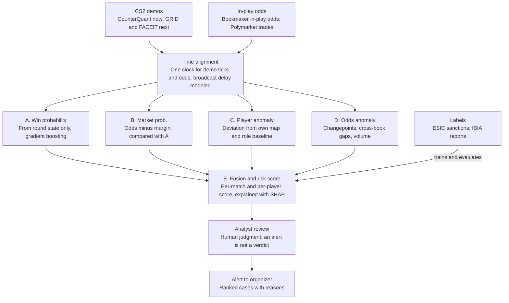

# CS2 Match-Fixing Detection Spec

Oct 17, 2026 · @tman

## Goal and scope

We are building a game-side integrity layer for Counter-Strike 2 that flags matches where live betting markets move in ways the game state doesn't explain.

- **In scope:** pro and semi-pro CS2 matches, with priority on tier 2 and tier 3, where fixing is cheapest and existing monitors look least.
- **Users:** tournament organizers and integrity bodies, who receive ranked, explained alerts for human review.
- **Not in scope:** competing with bookmaker-side monitors such as Sportradar's UFDS or IBIA on odds coverage or account-level data, or issuing verdicts. An alert means "worth investigating," never "fixed."

## Decisions

| # | Decision | Choice | Why | Decided |
| --- | --- | --- | --- | --- |
| 1 | Game title | Counter-Strike 2 | Public tick-level demos, round structure suits per-round models, history of lower-tier fixing cases | Oct 17, 2026 |
| 2 | Positioning | Complement existing market monitors with a game-side evidence layer | Can't match their bookmaker and account coverage; they acknowledge gaps in competition coverage, borderline alerts and prediction markets | Oct 17, 2026 |
| 3 | Core signal | Market-implied probability vs. a game-state win-probability model, flagged when the market moves before the game justifies it | Measures informed betting directly, and explains each alert | Oct 17, 2026 |
| 4 | Demo source | CounterQuant CS2 Demos (Hugging Face) first; no direct HLTV scraping | Tier 1 and 2 demos since Jan 2024, CC BY 4.0; HLTV has no API and sits behind Cloudflare | Oct 17, 2026 |
| 5 | Official data | Apply to GRID Open Access in parallel | Free official historical CS2 data with cleaner timestamps; path to live data later | Oct 17, 2026 |
| 6 | Demo parsing | `demoparser2` or `awpy` | Standard open parsers; CounterQuant's own datasets use `demoparser2` | Oct 17, 2026 |
| 7 | Labels | Unsupervised backbone + PU learning on known sanctions + synthetic injection | Confirmed fixes are too rare for plain supervised learning | Oct 17, 2026 |

## Data sources

Demos and labels are settled; the in-play odds source is not (see Open questions).

| Source | Role | Coverage | Status |
| --- | --- | --- | --- |
| [CounterQuant CS2 Demos](https://huggingface.co/datasets/KEDevO/CounterQuant-CS2-Demos) | Raw .dem files for game-state and player models | Tier 1 and 2, Jan 2024 onward, 3.74 TB+, updated 24–48h after matches | Chosen |
| [CounterQuant Bronze / GoldLite](https://huggingface.co/datasets/KEDevO/CounterQuant-CS2-GoldLite) | Pre-parsed tick events; match-level Elo, form, head-to-head features | Same matches | Use for prototyping |
| [GRID Open Access](https://grid.gg/?p=9774) | Official historical match data for timestamp alignment | Select CS2 tournaments, historical only | To apply |
| FACEIT Data API | Demos for tier 3 and league play | FACEIT-hosted matches | To evaluate |
| [PureSkill.gg](https://docs.pureskill.gg/datascience/adx/cs2/csds/) | Pipeline testing and behavior pretraining | Matchmaking and FACEIT, not pro | Optional |
| In-play odds | Market-implied probability | TBD | Undecided |
| Polymarket trades | Wallet-level market evidence outside bookmaker monitors | CS2 markets listed there | To evaluate |
| Sanction records (ESIC, IBIA reports) | Positive labels and evaluation | Historical cases | Chosen |

CounterQuant's CC BY license comes from its curator, while the demos originate from HLTV; recheck that chain before any commercial use.

## System design

Game and market data share one clock, four models score it, and the fusion layer ranks cases for a human reviewer; known sanctions train and evaluate the fusion step.

## Milestone 1

Prove the data alignment works: a round win-probability model for tier-2 CS2, overlaid on historical in-play odds, showing where market and model diverge.

- [ ] Download one recent year of tier-2 demos from CounterQuant
- [ ] Parse demos into per-round snapshots (alive players, equipment value, health/armor, bomb state, time, map, score, side, economy state)
- [ ] Train a gradient-boosted round win-probability model and check calibration
- [ ] Source historical in-play odds for the same matches and remove bookmaker margin
- [ ] Sync demo ticks and odds timestamps to one clock, modeling broadcast delay
- [ ] Rank rounds by market–model divergence where the market moved first, and review the top cases by hand

**Done when:** the top-ranked divergences are explainable by real game events or plausible market behavior, not by timestamp errors.

## Open questions

- [ ] Where do historical in-play CS2 odds come from (bookmaker feed, odds aggregator, exchange data), and at what timestamp resolution?
- [ ] What broadcast delay do target tournaments use, and how do we measure it per event?
- [ ] Does CounterQuant's tier-2 coverage reach the leagues we care most about, or do we need FACEIT for tier 3?
- [ ] Is the CounterQuant licensing chain acceptable if the project goes commercial?
- [ ] Which past ESIC CS cases have enough match data to serve as labeled positives?
- [ ] Who is the first target user: a specific tournament organizer, or an integrity body?

## Sources

- [Sportradar – Anti-Match-Fixing Detection](https://sportradar.com/integrity-regulatory/integrity/anti-match-fixing/detection/)
- [The Edge Malaysia – Integrity tech: Tackling match-fixing with tech](https://theedgemalaysia.com/node/598005)
- [AGBrief – IBIA reports 76 suspicious betting alerts in Q2 2026](https://agbrief.com/news/world/23/07/2026/ibia-reports-76-suspicious-betting-alerts-in-q2-2026/)
- [Esports.net – IBIA flags up increase in esports match-fixing](https://www.esports.net/news/ibia-esports-match-fixing-increase)
- [CounterQuant CS2 Demos – Hugging Face](https://huggingface.co/datasets/KEDevO/CounterQuant-CS2-Demos)
- [CounterQuant CS2 GoldLite – Hugging Face](https://huggingface.co/datasets/KEDevO/CounterQuant-CS2-GoldLite)
- [GRID Open Access](https://grid.gg/?p=9774)
- [PureSkill.gg CS2 dataset docs](https://docs.pureskill.gg/datascience/adx/cs2/csds/)
