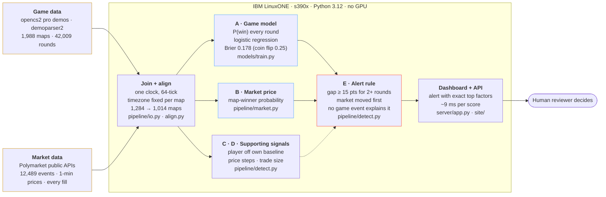

# Architecture

Everything inside the dashed box runs in the s390x container on IBM LinuxONE. Data never enters the repo.

F (`pipeline/inject.py`) inserts labelled, simulated prints for the demo alert; it is left out of the diagram for clarity.

Team One 95 · IBM Z Datathon 2026 · SSF2026
